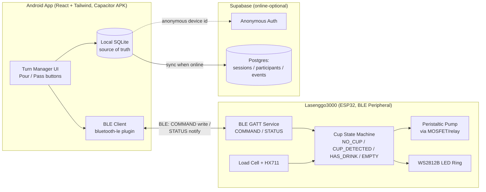

# ARCHITECTURE.md — Lasenggo 3000

## System Diagram


## Tech Stack Decisions

| Layer | Choice | Why |
|---|---|---|
| Frontend | React + Tailwind | Team familiarity; fast UI iteration |
| Native wrapper | Capacitor → Android APK | Avoids Web Bluetooth's unreliability/iOS lockout; ships as installable app |
| Bluetooth | `@capacitor-community/bluetooth-le` (native BLE) | No internet dependency (rural/outdoor use case); more reliable than browser Web Bluetooth |
| Local storage | SQLite (`@capacitor-community/sqlite`) | Offline-first source of truth; schema maps directly to Supabase/Postgres, so sync is a straight row copy, not a transform |
| Cloud sync | Supabase (Postgres + anonymous auth) | Online-optional; zero-login UX fits casual party use; Postgres gives real querying for future stats |
| Firmware target | ESP32 | Built-in BLE, enough GPIO/ADC for pump + load cell + LED, no separate Arduino needed |

## Key Design Patterns
- **Hardware stays "dumb"**: turn order and participant logic live entirely in the app.
  The ESP32 only executes `POUR`/`TARE`/`STOP` and reports sensor state — it has no
  concept of "whose turn it is." Keeps firmware simple and keeps all business logic in
  one place (the app) for easier iteration.
- **Delta-based sensing, not fixed thresholds**: cup presence/liquid detection compares
  weight *before* vs *after* a pour rather than relying on fixed absolute weight bands.
  This makes the system agnostic to whatever cup/glass shape someone brings to the
  circle — a core requirement given how tagayan is actually used.
- **Offline-first, sync-second**: every write goes to local SQLite first and always
  succeeds. Supabase sync is a best-effort background process; the app's core loop
  (list → pour/pass → confirm) never blocks on network state.
- **Event log, not aggregate-only**: the data model stores individual pour/pass events,
  not just summary counts. Summaries are derived via query; the reverse is impossible.
  This keeps the door open for future stats features without a schema migration.

## Data Models / Schema

```sql
-- One row per tagayan session (a "party"/gathering)
sessions (
  id uuid primary key,
  device_id text,            -- anonymous auth user id
  name text,                 -- optional custom title (app/session-naming);
                              -- null falls back to showing started_at in the UI
  started_at timestamptz,
  ended_at timestamptz,
  mode text,                 -- 'manual' (logged by hand) | 'hardware' (ran with
                              -- the Lasenggo 3000 device); default 'manual'
  synced_at timestamptz      -- null until successfully pushed to Supabase
)

-- One row per participant per session
participants (
  id uuid primary key,
  session_id uuid references sessions(id),
  name text,
  person_id uuid references people(id)  -- nullable; links forward to a roster
                                          -- entry (app/people-roster). This row
                                          -- keeps its own independent `name` copy
                                          -- regardless, so an old session never
                                          -- changes if a roster name is renamed
                                          -- or the roster entry is deleted later.
)

-- A recurring "who comes to tagayan" roster, separate from any one session's
-- participants rows. Powers name-autocomplete at session start and is the
-- forward-looking anchor for a future cross-session leaderboard (Tagay
-- King/Queen, part B — see TASKS.md backlog). Entries are created implicitly
-- the first time a name is typed at session start (findOrCreatePerson,
-- case-insensitive match) — there's no separate "add to roster" control.
people (
  id uuid primary key,
  name text,
  created_at timestamptz,
  last_used_at timestamptz   -- bumped on every reuse; drives
                              -- most-recently-used ordering in the
                              -- autocomplete list
)

-- One row per pour/pass/pause/resume event
events (
  id uuid primary key,
  session_id uuid references sessions(id),
  participant_id uuid references participants(id),
  type text,                 -- 'POUR' | 'PASS' | 'PAUSE' | 'RESUME' | 'TIMEOUT'
                               -- (TIMEOUT: turn timer ran out; note = '30s')
  volume text,                -- 'light' | 'standard' | 'heavy', POUR only, else null
  note text,                  -- pause reason (Drunk/Went home/Run away/Emergency/
                               -- Other), PAUSE only, else null
  outcome text,               -- POUR only: 'finished' | 'partial' | 'tapon';
                               -- null = never recorded (app/drink-outcome)
  left_ml integer,            -- POUR only: estimated mL left in the cup
                               -- (0 finished, whole pour for tapon)
  timestamp timestamptz
)

-- app/saved-drinks: remembered drinks for tap-to-fill (the drinks
-- counterpart of `people`); one row per name + bottle size. Filled
-- automatically whenever a drink is logged. Not referenced by `drinks`:
-- editing a saved drink never changes past sessions.
saved_drinks (
  id uuid primary key,
  device_id uuid,            -- RLS: device_id = auth.uid()
  name text,
  volume_ml integer,
  created_at timestamptz,
  last_used_at timestamptz   -- sort order: most recently used first
)
```
Local SQLite mirrors this exactly, plus a `synced boolean` flag per row used by the sync
job to find unsynced records. `volume`, `note`, and `participants.person_id` were all
added after their tables' initial creation via idempotent `ALTER TABLE ... ADD COLUMN`
migrations in `db.js` (`migrateAddEventVolume`, `migrateAddEventNote`,
`migrateAddParticipantPersonId`), same pattern as `sessions.name`. Each migration checks
`PRAGMA table_info` first and only runs the `ALTER TABLE` if the column is actually
missing, rather than firing it unconditionally and swallowing a "duplicate column"
error — the swallow-based version worked, but on web (`jeep-sqlite`) the swallowed
rejection still surfaced as a confusing "Uncaught (in promise)" console error on every
dev-mode remount. `people` syncs to Supabase too (`backend/supabase-resume-catchup`),
device-scoped the same way `sessions` is (a `device_id` column + an
`device_id = auth.uid()` RLS policy, since a person isn't tied to one session the
way participants/events are) rather than through the EXISTS-subquery pattern
`participants`/`events` use. Supabase's `events.type` CHECK constraint, and
`events.volume`/`events.note`, both lagged behind local SQLite for a while — added
locally for `app/pause-reason-tag`/the pour-volume breakdown while the Supabase
project was paused, and only caught up once it was resumed. See TASKS.md for the
full catch-up notes if a future schema change needs this history.

## BLE API (App ↔ ESP32)

Custom GATT service, advertised as `"Lasenggo3000"`.

**COMMAND characteristic (Write, App → ESP32):**
| Command | Meaning |
|---|---|
| `POUR` | Trigger pour for current person at the configured volume |
| `TARE` | Re-zero the load cell |
| `STOP` | Emergency stop pump mid-pour |

**STATUS characteristic (Notify, ESP32 → App):**
| Status | Meaning |
|---|---|
| `READY` | Idle, no cup |
| `CUP_DETECTED` | Cup placed, empty |
| `NO_CUP` | Pour attempted, no cup — rejected |
| `POURING` | Pump active |
| `POURED` | Pour completed |
| `HAS_DRINK` | Liquid confirmed (LED on) |
| `EMPTY` | Cup emptied/removed (LED off) |

Any change to this command/status vocabulary must be reflected here and in firmware +
app code in the same PR — this table is the contract between the two codebases.

**Drink outcome (app/drink-outcome):** after `POURED`, the app holds the turn on the
drinker until the pour's outcome is recorded. Today that's a manual tap (Finished /
Left some / Tapon). With hardware, `HAS_DRINK` → cup lifted → cup returned at roughly
its pre-pour weight can record `finished` automatically, and a heavier return weight
can record `partial` with `left_ml` from the weight difference. The scale cannot tell
drinking apart from pouring the drink out, so `finished` means "the cup came back
empty", not proof it was drunk. No new COMMAND/STATUS values are needed for this.

## Feature-Based Architecture (app folder structure)
Scaffolded and live as of `app/project-scaffold` (2026-10-05) — React + Tailwind v4 +
Capacitor project with this structure in place under `src/`, confirmed running via
`npm run dev`:
```
src/
  features/
    session/        # participant list, turn manager, session lifecycle
    pour/            # pour volume setting, pour/pass actions, BLE command dispatch
    ble/             # BLE connection, scan, characteristic read/write/subscribe
    storage/         # SQLite schema, local read/write, sync queue
    sync/            # Supabase client, anonymous auth, push/pull sync job
    history/         # past-session browsing (list/detail), added in app/history-list —
                      # not in the original proposal, reads via storage/sessionQueries.js
  shared/
    components/      # shared UI (buttons, status indicators)
    hooks/
    types/
```
Each feature folder owns its own state/logic; cross-feature calls go through a small
explicit interface rather than reaching into another feature's internals. Scaffolded and
live as of `app/project-scaffold`; most folders now have real code (see `TASKS.md` for
per-task status) — `ble/` and `sync/` are still empty, pending their tasks.

## References
- Full original decision log/rationale: see `DECISIONS.md`
- Sensor/component list: see `PRD.md`
- Task breakdown: see `TASKS.md`
